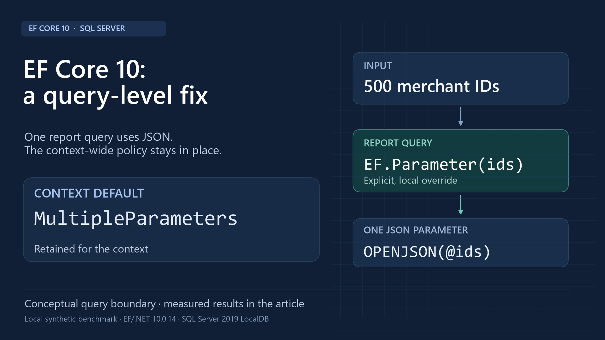

# EF Core 10 financial-report benchmark

Version 0.1.0 · [MIT license](LICENSE) · [Source and measurement download](https://github.com/pouriajamali/efcore-report-benchmark/releases/tag/v0.1.0)

[](https://github.com/pouriajamali/efcore-report-benchmark/actions/workflows/verify.yml)



A reproducible SQL Server experiment with synthetic transactions: the same report, data and
covering index, under three collection-translation modes in EF Core 10.0.14.

This is a comparison within EF10. It is not an EF8-versus-EF10 upgrade benchmark,
production workload, cloud-capacity test, or universal recommendation.

## What the report does

Filter successful transactions by selected merchant IDs, then return each merchant's
transaction count and exact amount total. Amounts use integer minor units.
The source is in `Benchmark/Program.cs`; deterministic data is in `seed.sql`.

1,000,000 transactions / 10,000 merchants. IDs1..1000 have80% of rows; the remaining
9000 have20%. Both bands are tested with5,50,500 selected merchants. Every result
is validated against independently generated integer aggregates. Actual stored rows
are streamed and SHA256-checked against the independent generator.

## Recorded measurements

500 low-volume merchants; median client milliseconds:

| Collection translation | Same list, warm | Fresh lists, compile-inclusive |
|---|---:|---:|
| MultipleParameters | 7.72 | 7.41 |
| Parameter / JSON | 2.40 | 2.50 |
| Constant | 2.38 | 15.58 |

The fixed-list phase has60 timed observations per case/mode, spread across three
rounds with five untimed warmups each. The fresh-list phase has15 per case/mode.
Mode order is randomized and balanced. One client; no concurrent requests.

`results/samples.csv` contains1350 primary timed observations, across all six cases
and three modes. `results/summary.json` includes medians and nearest-rank p95.
All450 matching-input triplets have identical counts, totals and result hashes.

The separate scoped check retains the context's MultipleParameters setting and uses
`EF.Parameter(ids)` in just the report predicate. It records30 warmed observations
per variant:8.54ms original vs2.88ms override. All result fingerprints match.
These follow-up numbers are a separate phase, not replacements for the table above.

The high-volume500 case has a smaller difference:41.36ms scalar vs36.15ms JSON.
All cases are retained; the low-volume example is not a general speedup claim.

## Environment and counters

- .NET/EF Core10.0.14; SDK10.0.403; SQL Server2019 LocalDB15.0.4382.1.
- Compatibility150; MAXDOP1; fixed covering index `(MerchantId,Status) INCLUDE(AmountMinor)`.
- FULLSCAN statistics after seeding; statistics unchanged throughout the experiment.
- Database-scoped procedure cache cleared between rounds; buffer pool stays warm.
- Client elapsed covers execution/materialization, with validation and export outside timing.
- SQL CPU/logical reads use timed DMV deltas after subtracting warmups. CPU precision is
  approximately milliseconds per execution. Compilation time was not isolated.
-18 actual execution plans were captured separately after timing. Their instrumentation
  overhead is excluded from the latency observations and reported timed DMV counters.
- SQL-text shape counts are not plan-cache memory or cache-bloat measurements.

## Reproduce on Windows

Install a .NET10 SDK and SQL Server2019 LocalDB. No cloud account or SQL credentials
are required. This lab creates only its dedicated per-user LocalDB instance/database.
The runner stops that dedicated instance and retains data files after completion.

```powershell
./run-local.ps1 -Dotnet 'C:/path/to/dotnet.exe'
```

The locked restore and Release build must pass before measurement. An existing result
folder is archived before a new run. The complete1M-row expected dataset SHA256 is:

`8d98e4e43596fd0ab4fd2f2de5fa57b941bb72081ec53a96ebdd810ebbda2207`

For analysis and figures, with Python3.12:

```powershell
python -m pip install --target .work/plot-packages -r requirements-plot.txt
$env:PYTHONPATH = (Join-Path $PWD '.work/plot-packages')
python analyze.py
python design_publication.py
```

The summary calculations use Python's standard library; Matplotlib renders graphics.
Segoe UI/Consolas, supplied by Windows, are used for the editorial design assets.
Timings will vary with hardware, data/cache state and SQL Server version. Original
source/build hashes are provenance for the recorded run, not a timing guarantee.

Primary reference: [EF Core 10 collection translation](https://learn.microsoft.com/en-us/ef/core/what-is-new/ef-core-10.0/breaking-changes#parameterized-collections-now-use-multiple-parameters-by-default).

## License

The original lab source, synthetic measurements and diagrams are provided under MIT.
Referenced NuGet packages retain their own licenses. No employer code or data is included.

## Verification and CI

`python scripts/verify_evidence.py` independently recalculates every recorded summary,
checks matching outputs and raw-counter deltas, and verifies the file/source manifest.
CI restores locked dependencies, builds the C# harness and runs that verifier on Linux.
It does **not** run LocalDB or produce new SQL timing observations. The recorded SQL
experiment and separate query-scoped check were executed on the documented Windows host.

Useful entry points: [report and harness](Benchmark/Program.cs),
[raw observations](results/samples.csv), [complete summary](results/summary.csv),
[actual plans](results/plans), and [seed](seed.sql).
